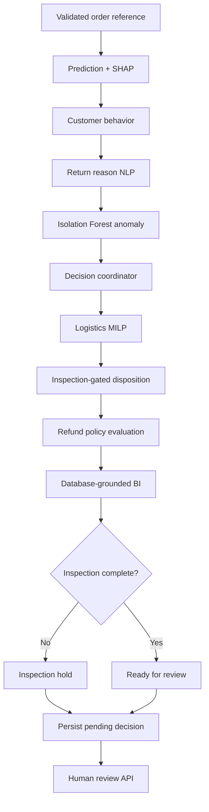

# Architecture

The data module generates and validates transactions, keeps raw/clean outputs separate, and imports normalized customers, products, orders, order items, returns and warehouses. ML transforms features through a persisted ColumnTransformer and estimator. Isolation Forest shares the same eligible input features.

FastAPI validates requests through Pydantic and calls services, not fabricated frontend data. SQLAlchemy sessions scope transactions. Foreign keys and indexes enforce ownership of order-linked records; SQLite foreign-key enforcement and WAL are enabled. The same models support PostgreSQL. All recommendation creation and human review events append audit records.

The graph uses typed shared state and a bounded recursion limit:

Nodes execute sequentially to keep audit order deterministic and avoid concurrent SQLAlchemy session sharing. Every successful node commits a structured output and duration. A failure logs the failing node and stores a failed decision, preserving prior completed work. No node loops. The coordinator flags anomaly conflicts for review. The graph produces recommendations only.

Logistics solves binary facility selection using SciPy MILP, exactly one feasible warehouse per order. Constraints filter available units, category capabilities, processing/transit deadline and transport units. The cost objective includes estimated transportation, processing, handling, holding and configurable carbon penalty. Repair cost is considered in the disposition stage. The optimizer does not implement fleet vehicle routing, multi-order consolidation, capacity reservation or live carrier measurements.

Disposition evaluates condition-compatible recovery options and subtracts repair/handling costs. Unsafe products cannot be restocked or resold. Without inspection, no disposition is finalized. Refunds use an explicit request date, proof of purchase, configured return window and discounted order value. Neither endpoint executes money transfers.

The browser dashboard uses Axios and a Next.js API rewrite. It provides loading, error and empty states, paginated directories, interactive Recharts, JSON detail views, forms and approval controls. Synthetic provenance is visible throughout.

The optional shared API key secures application API routes. Health checks, OpenAPI and synthetic report files remain public. Reports must be protected before sensitive operational datasets are introduced. Reviewer identity is a supplied label in local demo mode, not independently verified identity. Production authorization must derive reviewers from a trusted identity provider.
